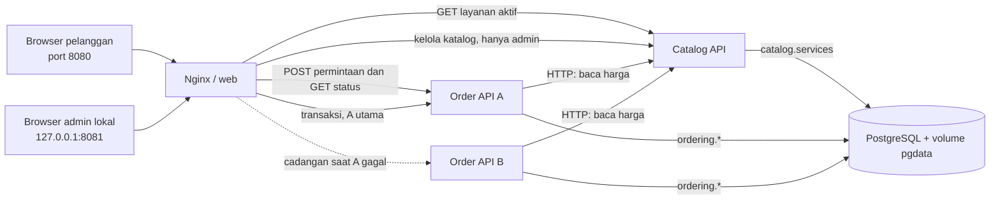

# SmartLoundry — Laundry Mr Andy

**Pratinjau GitHub Pages:** [maddd327.github.io/SmartLaundry](https://maddd327.github.io/SmartLaundry/). Link ini hanya menyajikan file statis; katalog, penyimpanan permintaan, dan pelacakan membutuhkan Flask serta PostgreSQL yang berjalan pada server. Untuk demo seluruh alur, gunakan Docker Compose seperti petunjuk di bawah.

Proyek tugas cloud computing ini menampilkan website laundry dan panel operasional tanpa login. Frontend memakai HTML, CSS, dan JavaScript biasa. **Catalog API** mengelola layanan/harga; **Order API** mengelola pelanggan, order, item, pembayaran, pengeluaran, dan laporan. Keduanya adalah *microservice* karena memiliki tanggung jawab dan tabel sendiri; Order API mengambil harga dari Catalog API lewat HTTP, lalu menyimpan nama/harga sebagai snapshot item. **Order API A dan B adalah dua replika dari microservice yang sama**, dengan image/kode dan PostgreSQL yang sama. B melayani saat instance A berhenti.

## Arsitektur



| Container | Fungsi dan data |
| --- | --- |
| `web` | Nginx menyajikan halaman publik/POS dan membatasi route menurut port; tidak memiliki tabel. |
| `catalog-api` | Flask pemilik tabel `catalog.services`; hanya layanan aktif dapat dibaca dari port publik. |
| `order-api-a`, `order-api-b` | Dua instance Flask dari image yang sama, pemilik tabel `ordering.customers`, `orders`, `order_items`, `payments`, dan `expenses`. Laporan dihitung dari data tersebut; endpoint lacak publik hanya mengembalikan status dan perkiraan selesai. |
| `db` | Satu PostgreSQL untuk kedua service, dengan volume `pgdata`. Infrastruktur database masih bersama dan belum memiliki failover. |
| `db-migrate` | Job sekali jalan pada Compose: menerapkan SQL berulang ke volume lama maupun baru, lalu berhenti. |

API dan database tidak menerbitkan port host. Nginx mengikat port admin hanya ke `127.0.0.1`; menyembunyikan tombol UI saja bukan pembatas akses.

## Menjalankan

Di akar proyek, buat `.env` sekali untuk tiga password acak lokal, lalu jalankan Compose:

```bash
python3 scripts/setup_env.py
docker compose up --build -d
docker compose ps
```

`.env` berizin hanya untuk pemilik dan diabaikan Git serta build Docker. Simpan salinannya secara privat untuk pemulihan. Job `db-migrate` menerapkan perubahan skema pada volume lama saat Compose dijalankan; seed tidak menimpa transaksi.

| Halaman | URL pada mesin host |
| --- | --- |
| Pelanggan | `http://localhost:8080/` |
| POS admin | `http://127.0.0.1:8081/operasional.html` |

Pengelola dari komputer lain perlu jaringan privat atau SSH tunnel ke port admin lokal. Tidak ada halaman login. Saat website pelanggan dipasang pada domain sebenarnya, gunakan **HTTPS** dengan domain/sertifikat deployment yang valid dan pastikan POS tetap di jaringan privat. Compose lokal ini hanya memakai HTTP.
GitHub menyimpan kode proyek, bukan menjalankan Flask atau PostgreSQL. Agar pelanggan internet dapat menyimpan permintaan, stack ini harus dijalankan pada server yang dapat dijangkau publik untuk port website, sementara port admin tetap privat.

## Alur pelanggan dan transaksi

Website publik membaca layanan aktif dan harga acuan dari `GET /api/services`. Pelanggan mengisi form, memeriksa rincian, lalu menekan **Simpan permintaan**. Browser memanggil `POST /api/requests`; Order API menormalisasi nomor, menghitung ulang harga dari Catalog API, serta menyimpan pelanggan, permintaan, dan item dalam satu transaksi. Server mengembalikan kode lacak UUID. Status awal **Menunggu konfirmasi**; pengelola melihatnya di POS dan mengubah status ke **Antre** setelah memeriksa rincian. Pembayaran baru dapat dicatat setelah konfirmasi. `client_request_id` mencegah retry membuat permintaan ganda. Pelanggan dapat membuka WhatsApp dengan rincian dan kode yang sudah terisi, tetapi **tetap harus menekan Kirim sendiri**. Menyimpan permintaan tidak membuktikan chat terkirim atau laundry diterima outlet. Harga serta jadwal akhir tetap perlu dikonfirmasi. Kode dapat dipakai di bagian **Lacak Order** untuk melihat status. POS juga dapat mencatat order langsung melalui `POST /api/orders`.
Tanpa login atau verifikasi nomor, siapa pun dapat mengirim permintaan publik. Pengelola perlu memeriksa identitas dan rincian sebelum mengonfirmasi; status menunggu konfirmasi serta blokir pembayaran awal memang disediakan untuk langkah ini.

## Contoh API

```bash
curl -i http://localhost:8080/api/services
curl -i 'http://localhost:8080/api/track?code=ID-ORDER-DARI-STRUK'
curl -i http://127.0.0.1:8081/api/orders
```

Pada database baru yang belum memiliki order, respons contoh `GET /api/orders` ialah:

```http
HTTP/1.1 200 OK
Content-Type: application/json
X-Instance-ID: order-api-a

{"orders":[]}
```

Endpoint admin lain meliputi `POST /api/services`, `POST /api/customers`, `POST /api/orders`, `PATCH /api/orders/{id}/status`, `POST /api/orders/{id}/payments`, `GET /api/orders/{id}/receipt`, dan `GET /api/reports/summary?from=YYYY-MM-DD&to=YYYY-MM-DD`. `GET /api/track?code=<UUID>` di port publik hanya mengembalikan kode, status, perkiraan selesai, dan waktu pembaruan; tidak mengembalikan nama, nomor WhatsApp, rincian, atau pembayaran. Port publik juga mengizinkan **hanya** `POST /api/requests` untuk membuat permintaan menunggu konfirmasi. Galat API berbentuk JSON seperti `{"error":"Pelanggan tidak ditemukan."}` dengan status HTTP yang sesuai. Rincian kontrak ada di [panduan backend](backend/README.md). Port publik menolak POS dan API pengelola; `GET /api/services` hanya memberi layanan aktif.

## Demo maintenance dan failover

1. Jalankan Compose seperti di atas. Buat pelanggan dan order melalui POS, lalu lihat detailnya. `curl -si http://127.0.0.1:8081/api/orders` menampilkan `X-Instance-ID: order-api-a`.
2. Jalankan `docker compose stop order-api-a`. Buat dan baca order lain dari POS; ulangi `curl` tadi dan tunjukkan header `X-Instance-ID: order-api-b` serta order pertama tetap ada.
3. Jalankan `docker compose start order-api-a`. Setelah A sehat dan jeda failover pasif sekitar 5 detik, baca daftar lagi: A dapat melayani, dan kedua order masih ada.
4. Jalankan `docker compose restart catalog-api order-api-a order-api-b web`; buka riwayat POS lagi untuk membuktikan data tetap ada pada volume PostgreSQL.

Nginx memakai A sebagai utama dan B sebagai cadangan. Ini membuktikan failover **instance Order API pada satu komputer**, bukan ketahanan jika Nginx, PostgreSQL, atau seluruh host Docker mati.

## Backup dan restore

Backup ke folder lokal yang diabaikan Git:

```bash
mkdir -p backups
docker compose exec -T db pg_dump -U postgres -d laundry -Fc --no-owner > backups/laundry.dump
```

Restore **mengganti data saat ini**. Simpan backup terbaru, hentikan aplikasi penulis, lalu pulihkan ke database yang sudah ada:

```bash
docker compose stop web catalog-api order-api-a order-api-b
docker compose exec -T db pg_restore -U postgres -d laundry --clean --if-exists --no-owner --exit-on-error < backups/laundry.dump
docker compose start catalog-api order-api-a order-api-b web
```

Jaga dump dan `.env` tetap privat. Jalankan pemeriksaan batas port dengan `python3 scripts/check_gateway.py`; tes serta hasil browser ada di [tests/README.md](tests/README.md). Gambar editorial adalah ilustrasi, bukan foto outlet.
